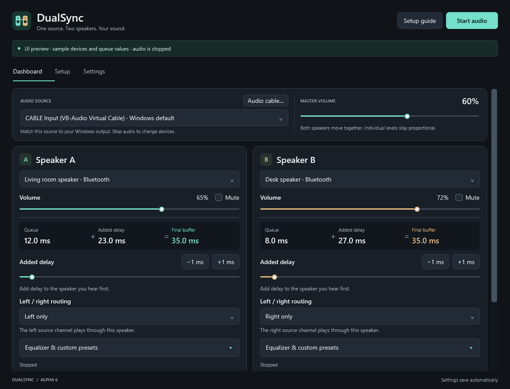
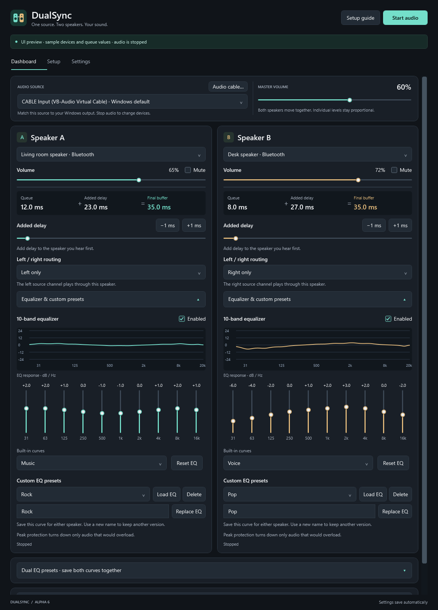

# DualSync

Play Windows audio through two speakers, with a separate EQ, volume, channel mix, and delay for each.

Built for setups such as two Bluetooth speakers that sound different or play slightly out of time. Tune each speaker, save your curves, and adjust the earlier speaker in 1 ms steps.

**Windows 11 · x64 · Portable alpha 6 · MIT**

This is a development alpha. The owner reports working playback, EQ, and Windows volume on their setup. Fresh-PC installation and longer hardware sessions are still being validated. A public release has not been published.



*Interface preview rendered from the app's XAML. Device names and queue values are sample data; audio is stopped.*

## What you can do

- Send one source to two different Windows playback devices.
- Tune each speaker with a 10-band EQ and peak protection.
- Save custom EQ curves for either speaker, or save both curves together as a dual preset.
- Set master and per-speaker volume, mute, and stereo/left/right/mono/custom routing.
- Add 0–500 ms of delay with a slider and ±1 ms buttons.
- Read each speaker's live queue + added delay = final software buffer.
- Save full setups containing devices, EQ, levels, routing, and delay.
- Keep playback running in the tray and retry devices during an active session after a disconnect.

Independent Bluetooth devices have their own clocks and buffers. Manual delay can improve a steady timing difference; it does not correct clock drift or guarantee sample-accurate synchronization.

## First playback

1. **Open the portable app.** Extract the whole ZIP and run `DualSync.exe`. Its .NET runtime is included. Quit any older DualSync instance from the tray first.
2. **Choose a source.** Open the app's Setup page. If you need a virtual source, choose **Set up audio cable** to reuse an existing VB-CABLE or open VB-Audio's official installer after opting in. Driver installation needs administrator approval and may need a restart.
3. **Route Windows audio.** Open Windows Sound settings and select the same source as your Windows output. For standard VB-CABLE this is usually **CABLE Input**. Record your previous output so you can switch back later.
4. **Choose two speakers.** On the Dashboard, select a source and two different outputs, then press **Start audio**. Mute each speaker in turn to verify both receive audio.
5. **Tune and save.** Open a speaker's Equalizer dropdown to adjust and save its curve. Add delay to the speaker you hear first. Dual EQ presets and full setup profiles are below the speaker cards.

The source must differ from both speakers, and the two speakers must be different devices. A physical source may also play the original audio; a suitable silent source avoids that extra playback. Stop audio before changing devices.

See the [setup guide](docs/installation.md), [cable setup details](docs/cable-setup.md), and [troubleshooting](docs/troubleshooting.md).

## EQ presets

Save **Rock** from Speaker A and **Pop** from Speaker B. Either saved curve can be loaded onto either speaker. To save that exact combination, save a dual EQ preset named **Indie**; loading it restores Rock to A and Pop to B together.

EQ presets save bands and enabled states. Full setup profiles also save devices, volume, mute, routing, and delay. Both types persist across restarts. Loading EQ works during playback; loading a full setup stops audio so you can check the route.



*Rendered interface with sample settings. Dual presets keep copies of both curves, so changing an individual preset later does not alter the saved pair.*

## Downloads and trust

There is no public download yet. Local builds create a self-contained ZIP and matching `.sha256` file under `artifacts`. Alpha 6 is unsigned; Windows security or organization policies may warn about or block it. See [signing status](docs/signing.md). Keep Windows security enabled.

The optional standard VB-CABLE driver is proprietary donationware from [VB-Audio](https://vb-audio.com/Cable/). It is downloaded on demand and is not included in this repository or the portable ZIP. Its setup helper checks the reviewed package hash and vendor signatures, preserves the original license, and opens the visible official installer. See [license and setup details](docs/cable-setup.md).

## Build

Requirements: Windows 11 and the .NET SDK pinned in `global.json`.

```powershell
./scripts/build.ps1 -Package
```

The script restores locked dependencies, builds the solution, runs 33 core tests and five Windows app tests, then packages the app with documentation and license notices. It also writes a ZIP checksum. CI uses the same script and uploads private workflow artifacts.

To regenerate the documentation previews without opening audio devices:

```powershell
dotnet tests/DualSync.App.Tests/bin/Release/net10.0-windows/DualSync.App.Tests.dll --screenshots docs/assets
```

The app icon is generated from `Assets/Brand.xaml` by `scripts/generate-artwork.ps1`. All original artwork is covered by the project's MIT license.

## Project structure

```text
src/
  DualSync.Core/          DSP, buffers, routing, profiles, EQ libraries, settings
  DualSync.Audio/         WASAPI capture, playback, and endpoint discovery
  DualSync.Setup/         Verified cable preparation and vendor installer launch
  DualSync.App/           WPF workspace, setup guide, artwork, and tray
tests/
  DualSync.Tests/         Synthetic-audio and persistence checks
  DualSync.App.Tests/     EQ workflows, template bindings, and preview renderer
tools/
  DualSync.Diagnostics/   Endpoint inspection and audio-engine diagnostics
docs/                   Setup, testing, architecture, and release preparation
scripts/                Build, package, and icon generation
```

See [architecture](docs/architecture.md), [test evidence](docs/testing.md), [release notes](docs/release-notes-alpha.6.md), and the [release checklist](docs/release-checklist.md). Remaining work centers on clean-machine setup, longer hardware sessions, reconnection/sleep testing, and distribution signing.

## License

DualSync's original code and artwork are [MIT licensed](LICENSE). Dependencies and the bundled runtime retain their own licenses; see [third-party notices](THIRD_PARTY_NOTICES.md). The separately installed VB-CABLE driver keeps VB-Audio's license.
